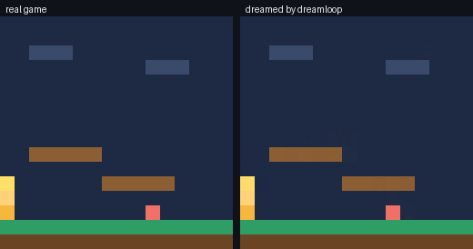
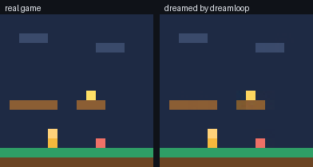
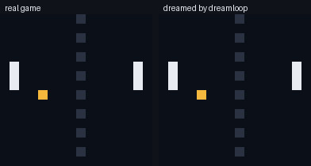
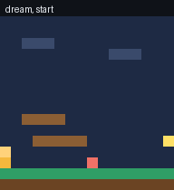

# dreamloop

**Record a simple game. Train a world model in about 15 minutes on your MacBook. Then play the dream.**

Every frame you see in `dreamloop play` is imagined by a neural network. The real game isn't running.



*Left: the real game. Right: dreamloop's dream. Both start from the same 4 real frames of a held-out episode (the first one, not picked for looking good). After that the dream sees no real frames. Each step it gets only an action, read from the real video by the latent action model.*

| Training time on M1 Pro | World model size | Playback | Gameplay used |
| --- | --- | --- | --- |
| 14 min | 2.9M params | ~110 fps (9 ms per frame) | 20 min |

Platformer, `small` preset, M1 Pro with 16 GB. Model size counts all three networks. Playback is how fast the model dreams; the browser shows it at the game's 15 fps. Gameplay is 112 training episodes of 160 frames at 15 fps; 8 more are held out for evaluation.

## How it works

1. **Record.** Gameplay video from a built-in game, or (experimental) a screen region of any simple game. No action labels are needed.
2. **Learn.** Three small networks in [MLX](https://github.com/ml-explore/mlx):
   - a **tokenizer** that turns each 64×64 frame into an 8×8 grid of discrete tokens (FSQ), one token per 8×8 patch,
   - a **latent action model** that invents 9 discrete "actions" that best explain how one frame becomes the next,
   - a **dynamics transformer** that predicts the next frame's tokens from the last few frames plus an action (MaskGIT decoding).
3. **Play.** Your keys pick latent actions. The network imagines every next frame, live in your browser.

## Quick start

Apple Silicon Mac with 16 GB+ of memory, Python 3.10+.

```bash
git clone https://github.com/Ssatyr/dreamloop
cd dreamloop
pip install -e ".[dev]"

dreamloop demo --game platformer --preset smoke   # under a minute: checks everything runs
dreamloop demo --game platformer --preset small   # about 15 minutes: the result above
dreamloop play --run runs/platformer-small        # opens the dream in your browser
```

Step by step:

```bash
dreamloop data  --game paddle --episodes 600 --steps 160
dreamloop train --data data/paddle.npz --out runs/paddle --preset small
dreamloop eval  --run runs/paddle      # how long the dream stays close to the real game
dreamloop dream --run runs/paddle      # side-by-side GIF for your README
dreamloop play  --run runs/paddle
```

Built-in games: `platformer`, `paddle`, `snake`. There is also an `overnight` preset with bigger models. It takes about 7 hours on an M1 Pro, and we haven't measured its results yet.

## How good is the dream?

On 8 held-out episodes per game, `small` preset:

| Game | Dream stays close (actions from video) | With your keys | At step 4: video actions vs. random actions |
| --- | --- | --- | --- |
| platformer | 19 steps (1.3 s) | 9 steps | 48.9 dB vs. 6.9 dB |
| paddle | 5 steps (0.3 s) | 0 steps | perfect vs. 2.5 dB |
| snake | 11 steps (0.7 s) | 1 step | 52.9 dB vs. 7.0 dB |

*Stays close:* the median number of steps before the dream drops below 20 dB PSNR. PSNR is measured only on the pixels that move, because about 99% of the pixels don't change from one frame to the next: on whole frames, even a frozen picture would score above 20 dB. A frozen picture scores about 5 dB on moving pixels, and a dream that is one step behind about 10 dB.

*Actions from video vs. your keys:* the latent actions describe what happened on screen ("moved right"), not which key was pressed. So a key maps to them only roughly. Walking into a wall looks like standing still, and in paddle the computer's paddle moves at random, which your keys can't tell the model. *Random actions:* the same dream with random actions, to check that the actions matter.

## Do the invented actions match the real controls?

The latent action model never sees which key was pressed. Built-in games record the true actions anyway, so we can check:

| Game | Purity | Consistency |
| --- | --- | --- |
| platformer | 82.2% | 58.6% |
| paddle | 96.4% | 54.4% |
| snake | 73.9% | 77.0% |

*Purity:* how often a latent action means one real action. *Consistency:* how often a real action gets the same latent action. Neither can reach 100%, because some moves look identical on screen (walking into a wall looks like standing still). In paddle, the actions also encode what the computer's paddle did, so each key is split across several actions.

## When dreams go wrong

World models drift, forget and improvise. The failures show what the network actually learned.

| Long rollouts | Random events | Effects, not keys |
| --- | --- | --- |
|  |  |  |
| The whole second held-out episode (10 s). Small errors compound: the player and enemy slowly drift away from the real game. | After a point, the real game serves the ball at a random spot. The dream can't know where, so it never serves at all. | Holding jump, the real player jumps, falls back and jumps again. The latent action for jump means "a jump just started", so the dream hovers and smears the sprite. |

Also: when the player touches the enemy, the real game sends it back to the start; the dream usually loses the player instead. Coins respawn at random, so the dream never knows where the next one appears.

## Record your own game (experimental)

```bash
pip install -e ".[record]"
dreamloop record --region 100,100,480,480 --minutes 20
dreamloop train --data data/recorded.npz --out runs/mygame --preset small
```

On macOS, allow your terminal under System Settings › Privacy & Security › Screen Recording. Not tested on macOS yet. The tokenizer is built for flat-colour pixel art; detailed textures will look blocky.

## Why

Interactive world models like DeepMind's Genie are among the most exciting ideas in AI right now, and most of them are out of reach. dreamloop is the pocket-sized version: small enough to train on a laptop and read in an afternoon.

## Built on

- [Genie: Generative Interactive Environments](https://arxiv.org/abs/2402.15391) (Bruce et al., 2024)
- [Finite Scalar Quantization](https://arxiv.org/abs/2309.15505) (Mentzer et al., 2023)
- [MaskGIT](https://arxiv.org/abs/2202.04200) (Chang et al., 2022)
- [TinyWorlds](https://github.com/AlmondGod/tinyworlds)

MIT license.
